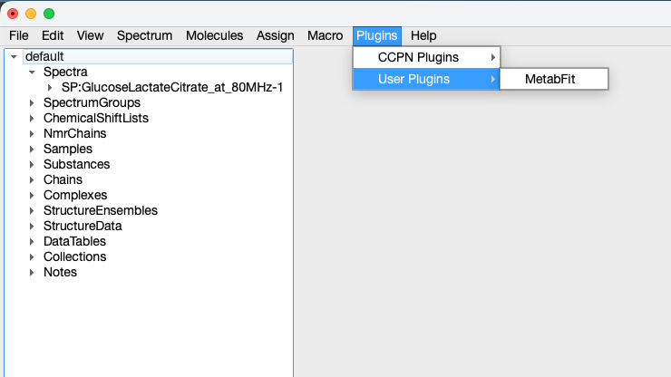
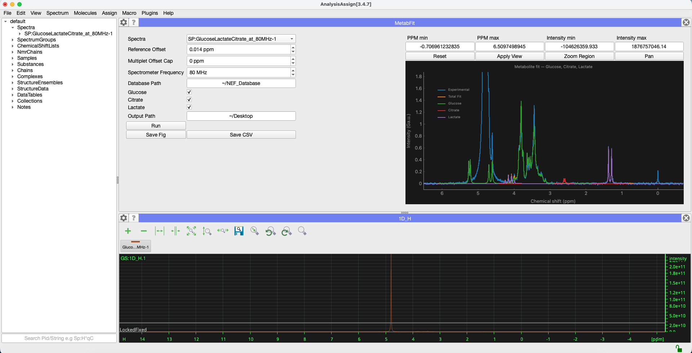

# MetabFit — NMR metabolite curve fitting

<p align="center">
  
</p>

MetabFit fits simulated metabolite references to experimental 1D NMR spectra inside CCPN. It reads NEF spin-system data and optimises each selected reference's amplitude, chemical-shift offset, and linewidth independently.

Developed for **CCPN 3.4.0** by **Alexander Hill and Morgan Hayward**. Plugin version: **0.0.1**.

See [CCPN downloads](https://ccpn.ac.uk/software/downloads/) for installation information.

## Features

- Interactive display of experimental NMR spectra.
- Simulation of metabolite references at a chosen spectrometer frequency.
- Fitting of individual metabolites and a summed total fit.
- Numeric axis limits, rectangle zoom, panning, and automatic scaling.
- PNG export of the visible plot and CSV export of all spectrum points.

## Requirements

The plugin requires **CCPN's plugin framework and AnalysisMetabolomics utilities**, including internal APIs. It cannot run as a standalone script; compatibility depends on the APIs available in your CCPN installation.

Versions recorded from the local CCPN installation are listed below. Dependencies must be available in CCPN's own Python environment.

| Package | Version | Purpose |
| --- | --- | --- |
| Python | 3.11.15 | Runtime interpreter |
| NumPy | 1.26.4 | Numerical arrays and spectrum handling |
| SciPy | 1.10.1 | Least-squares optimisation with `scipy.optimize.curve_fit` |
| pyqtgraph | 0.13.1 | Interactive spectrum display and PNG export |
| PyQt5 | 5.15.11 | GUI integration |

Download reference data from [CCPN CASMDB](https://github.com/ccpnmr/CASMDB). Store the NMR Exchange Format (NEF) files locally in the structure expected by CCPN's `NefDatabaseCaller`, with all configured spectrum IDs available.

## Installation

1. Download or clone this repository.
2. Open CCPN AnalysisAssign. In **Preferences**, set **Plugins path** to the directory where you want to keep your plugins.

   

3. Copy the complete `curveFit` folder into that directory, keeping its name and contents intact:

   ```text
   <CCPN plugins directory>/
   └── curveFit/
       ├── MetabFitPlugin.py
       ├── plugin_descriptor.json
       └── metabfit_icon.png
   ```

4. Restart CCPN, then choose **Plugins → User Plugins → MetabFit**.

   

## Quick start

1. Extract the [example dataset](Data/GlucoseLactateCitrate_at_80MHz.zip) and open its **1D NMR spectrum** in CCPN.
2. Open **MetabFit** and select the experimental spectrum under **Spectra**.
3. Replace **Database Path** with the location of your downloaded [CASMDB reference data](https://github.com/ccpnmr/CASMDB). All configured references must be available, including unchecked metabolites.
4. Set **Spectrometer Frequency** to **80 MHz** for the example, and select the metabolites to fit. Adjust **Reference Offset** if needed; keep **Multiplet Offset Cap** at zero for reproducible simulations.
5. Click **Run** to display **Experimental**, the selected metabolite traces (labelled by name), and **Total Fit**.
6. To inspect a region, enter ppm and intensity limits and click **Apply View**, or click **Zoom Region** and drag a rectangle over the peaks. **Reset** restores the full plot.
7. To save results, set **Output Path** to an existing directory or a filename, then click **Save Fig** for the visible plot or **Save CSV** for all data points. Files are saved only when you click a save button.



## Next steps

- **Fit your own spectra:** load a prepared 1D spectrum into CCPN, then open MetabFit and set the experimental proton frequency in MHz. If MetabFit was already open when you loaded the spectrum, close and reopen the module to refresh **Spectra**.
- **Add metabolites:** edit `metabolite_config` in [MetabFitPlugin.py](curveFit/MetabFitPlugin.py), supplying the exact NEF spectrum ID, fitting window, and a unique widget name. See [Adding or changing metabolites](#adding-or-changing-metabolites) for an example. Restart CCPN after code changes to load the updated configuration.
- **Compare and export regions:** adjust the view without refitting, then save each region under a different filename. See [Saving figures and data](#saving-figures-and-data).

## Controls

| Control | Meaning | Default |
| --- | --- | --- |
| Spectra | Experimental spectrum loaded into the CCPN project | No spectrum selected |
| Reference Offset | Offset added to reference chemical shifts before fitting | 0.014 ppm |
| Multiplet Offset Cap | Random offset applied independently to each reference multiplet, between minus and plus this value | 0 ppm |
| Spectrometer Frequency | Frequency used for simulation and linewidth conversion | 80 MHz |
| Database Path | Local directory containing the NEF reference data | `/Users/Data/NEF_Database`; replace locally |
| Metabolite checkboxes | References to fit and include in the plotted sum | All unchecked |
| Output Path | Existing directory or output filename; PNG and CSV use the same basename | Empty |
| Run | Prepare references, fit selected metabolites, and update the plot | Available |
| Save Fig | Save the current plot view as a PNG | Disabled until a fit is displayed |
| Save CSV | Save the displayed fit's full-resolution data as CSV | Disabled until a fit is displayed |
| PPM min / max | Numeric lower and upper chemical-shift bounds; Apply View commits edits | Current visible limits |
| Intensity min / max | Numeric lower and upper intensity bounds; accepts scientific notation | Current visible limits |
| Apply View | Apply both axis ranges exactly, without extra padding | Available |
| Reset | Fit all plotted traces into the view; fitting inputs are unchanged | Also applied after each successful Run |
| Zoom Region | Left-drag a rectangle to zoom into a region | Available |
| Pan | Left-drag to move the plot; mouse wheel zoom remains available | Initial mouse mode |

For reproducible simulations, keep **Multiplet Offset Cap** at zero. Nonzero values introduce random perturbations on each run; the plugin does not set a random seed.

## How fitting works

The plugin loads **all configured references**, including unchecked ones, applies reference and multiplet offsets, and simulates signals at the selected frequency. For each checked metabolite, it then:

1. Selects experimental points within the configured ppm bounds.
2. Fits a simulated lineshape using SciPy's `curve_fit`.
3. Optimises amplitude scale, an additional chemical-shift offset, and linewidth.
4. Evaluates the fitted reference across the experimental spectrum's full range.

The fitted references are summed as **Total Fit**. This is an independent fit to the original data for each compound, rather than a simultaneous mixture fit or residual-subtraction method. With no metabolites selected, Total Fit is zero.

The lineshape generator reconstructs a uniformly spaced, descending axis from the point count and extrema. Experimental points must follow that grid.

### Included references

| Metabolite | Reference compound | Fitting window (ppm) |
| --- | --- | --- |
| Glucose | alpha-D-glucose | 3.19–3.98 |
| Citrate | Citric acid | 2.37–2.82 |
| Lactate | D-lactic acid | 1.17–1.50 |

These windows are starting points from the implementation, not universal assignments. Check their suitability for your field strength, referencing, sample conditions, and signal overlap.

## Adding or changing metabolites

Edit `metabolite_config` near the start of [MetabFitPlugin.py](curveFit/MetabFitPlugin.py). Each entry defines a display name, NEF spectrum ID, fitting window, and unique widget attribute:

```python
'Lactate': {
    'spectrum_ids': ['nef_nmr_spectrum_d-lactic_acid_3`1`'],
    'ppm_bounds': (1.17, 1.50),
    'widget': 'lactateWidget',
},
```

The dictionary drives the checkboxes, database loading, and fitting loop. Restart CCPN after editing it to load the updated configuration.

- Preserve the complete NEF spectrum ID. Record lookup uses the full ID; filename lookup removes its first three underscore-separated fields and final identifier.
- Choose a fitting window containing useful signal and enough experimental data points to fit three parameters.
- Use a unique `widget` attribute name for each metabolite.
- Use **one spectrum ID per metabolite**: additional entries overwrite its simulated signals.

Every configured reference must be available, even when unchecked.

## Saving figures and data

**Save Fig** and **Save CSV** export the most recently displayed fit without refitting. Changes to spectrum selection or fitting inputs require another **Run**.

Set **Output Path** to an **existing directory** to create matching timestamped files:

```text
fitting_plot_2026-11-10_15-01-30_123456.png
fitting_plot_2026-11-10_15-01-30_123456.csv
```

Both buttons share a timestamp assigned when the fit is displayed. Alternatively, enter a filename such as `/path/to/results/sample.png` to save `sample.png` and `sample.csv`. The selected button replaces the supplied extension. The parent directory must exist; `~` expands to your home directory. Existing files require overwrite confirmation, and directories are not created automatically.

### Choosing a plot region

The controls above the plot change the view without refitting:

1. Enter both ppm and intensity limits, then click **Apply View** or press Enter. Each minimum must be smaller than its maximum; the ppm axis remains high-to-low from left to right. Scientific notation such as `1e6` is accepted.
2. Alternatively, click **Zoom Region**, then left-drag a rectangle over the peaks of interest. Click **Pan** to switch back to moving the plot by dragging. The mouse wheel zooms in either mode.
3. Numeric fields follow mouse changes. Apply typed edits before saving; the image uses the visible view.
4. Click **Reset** to show all traces again. A successful **Run** also resets the view.

For the lactate region, apply ppm limits `1.17`–`1.50` and suitable intensity limits, then click **Save Fig**. Use different filenames to retain several regions from the same fit.

### PNG figures

**Save Fig** exports the visible PyQtGraph plot at **2200 pixels wide**, preserving its aspect ratio, view limits, background, traces, title, axes, and legend proportions. The legend scales with the figure to match the GUI view. Output resolution is specified in pixels.

### CSV data

**Save CSV** writes a UTF-8 CSV with a header row and these columns:

1. `Chemical shift (ppm)`
2. `Experimental`
3. One column for each selected metabolite, in configuration order (for example, `Glucose`, `Citrate`, `Lactate`)
4. `Total Fit`

Intensities use the plot's arbitrary units. All points retain their original order regardless of zoom. With no metabolites selected, only chemical shift, Experimental, and a zero Total Fit are included. Parameter estimates and covariance are not exported.

## Scope and limitations

- Prepare experimental spectra beforehand: the plugin does not phase, baseline-correct, reference, or suppress solvent in the experimental data.
- Overlapping signals, distorted baselines, and mismatched references can affect the fitted results.
- The amplitude scale is **not automatically a concentration**. Quantitative interpretation requires appropriate calibration and experimental validation.
- Only amplitude is constrained to be non-negative. Chemical-shift offset and linewidth are unbounded, so inspect fits for physically implausible results.
- Fit parameters and covariance are calculated internally but are not currently presented in a results table or exported. There is no residual panel or automated goodness-of-fit report.
- Input validation is limited. Select a valid 1D spectrum, provide the configured references, and ensure fitting windows contain sufficient finite data.

## Troubleshooting

| Problem | Check |
| --- | --- |
| Plugin does not appear | Confirm the Plugins path, `curveFit` folder name, and descriptor; restart CCPN. |
| Import error | Check dependencies in CCPN's Python environment and the availability of AnalysisMetabolomics modules. |
| Reference cannot be loaded | Check Database Path and all configured IDs, including unchecked entries. |
| Fit fails or looks incorrect | Check referencing, spectrometer frequency, baseline, finite data, and fitting bounds. |
| Save buttons are disabled | Click Run and wait for a fit to be displayed. |
| No export is saved | Set Output Path to an existing directory or a filename with an existing parent directory, then click Save Fig or Save CSV. Check write permissions and any export warning. |
| Export shows a previous fit | Changes to spectrum selection or fitting controls require another Run. |
| Saved figure region is incorrect | Click Apply View after editing numeric limits, or zoom with the mouse; Save Fig uses the visible plot. |
| Axis limits are rejected | Enter finite numbers with minimum less than maximum for each axis, including ppm. |

## Related publication

A. D. Hill, G. Travish, M. Phelan, M. Hayward, and C. P. Welsch. “Detection Limits of Blood Metabolites at Physiological Concentrations Using Benchtop ¹H NMR.” *NMR in Biomedicine* **39**, no. 2 (2026): e70215. [doi:10.1002/nbm.70215](https://doi.org/10.1002/nbm.70215).

Please acknowledge the software and cite the related work where applicable when reporting results obtained with this plugin.

## Licence

MetabFit is distributed under the **MIT License**. See [LICENSE](LICENSE) for the full terms and copyright notice: **Copyright (c) 2025 Alexander Hill**. Preserve the copyright and permission notices when redistributing copies or substantial portions of the software.

CCPN, reference databases, and third-party dependencies retain their own licences; the repository's MIT licence does not relicense those materials. The publication acknowledgement above is separate from the MIT licence terms.
