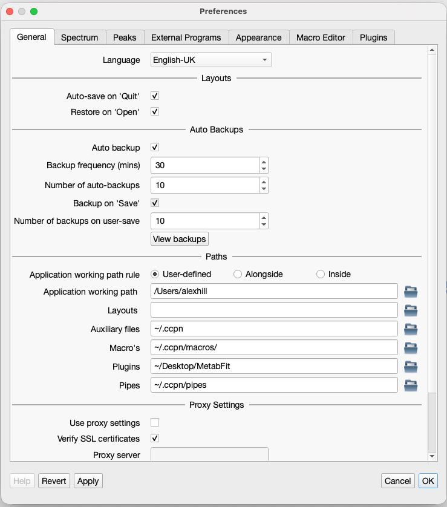

# MetabFit — NMR metabolite curve fitting

<p align="center">
  
</p>

MetabFit is a CCPN plugin for fitting simulated metabolite reference spectra to experimental one-dimensional NMR data. It generates reference spectra from NEF spin-system data, optimises their amplitude, chemical-shift offset, and linewidth, and overlays the results on the experimental spectrum.

Developed for **CCPN 3.4.0** by **Alexander Hill and Morgan Hayward**. The current plugin version is **0.0.1**.

## Features

- Reference simulation at a user-selected spectrometer frequency.
- Independent least-squares fitting within configurable metabolite-specific ppm windows.
- Interactive display of the sample, individual fitted references, and summed simulation.
- Labelled, 300-DPI figure exports with descending chemical-shift axes.
- Configuration-driven metabolite selection controls, reference IDs, and fitting windows.

## Requirements

This plugin runs **inside CCPN**, not as a standalone Python script. It requires CCPN's plugin framework and AnalysisMetabolomics database and simulation utilities, including internal APIs. Compatibility with other CCPN versions has not been established.

The Python environment used by CCPN must provide:

| Dependency | Purpose |
| --- | --- |
| NumPy | Numerical arrays and spectrum handling |
| SciPy | Least-squares optimisation with `scipy.optimize.curve_fit` |
| Matplotlib | Figure export |
| pyqtgraph | Interactive spectrum display |
| PyQt5 | GUI integration |
| CCPN, including AnalysisMetabolomics | Plugin framework, NEF access, and spin-system simulation |

Resolve missing dependencies in **CCPN's own Python environment**. Installing packages into an unrelated Python installation will not make them available to the application. Dependency versions are not currently pinned.

Obtain reference data separately from [CCPN CASMDB](https://github.com/ccpnmr/CASMDB), the database source identified by the plugin. Make the NEF reference files available locally in the structure expected by CCPN's `NefDatabaseCaller`, and confirm that they contain the configured spectrum IDs.

## Installation

1. Download or clone this repository.
2. In CCPN Preferences, set the **Plugins path** to a directory you control. See the screenshot below.
3. Copy the complete `curveFit` folder into that directory. Preserve its name: the entry point is `curveFit.CurveFitPlugin:CurveFitModule`.
4. Restart CCPN to discover the plugin, then open **Curve Fit Module** from the plugin menu.

```text
<CCPN plugins directory>/
└── curveFit/
    ├── CurveFitPlugin.py
    ├── plugin_descriptor.json
    ├── metabfit_icon.png
    └── ...
```

The Python module and [plugin descriptor](curveFit/plugin_descriptor.json) are required to load the plugin. The icon is referenced by the descriptor.



## Quick start

1. Open a CCPN project containing a processed, referenced **1D NMR spectrum**.
2. Open **Curve Fit Module** and select the experimental spectrum under **Spectra**.
3. Set **Database Path** to your local NEF reference database directory. The initial value is a developer-specific path and must be changed for your installation.
4. Set **Spectrometer Frequency** to the experimental proton frequency in MHz.
5. Select one or more metabolites to fit.
6. Optionally adjust the reference offset and multiplet offset cap.
7. Leave **Output Path** empty for interactive viewing only, or enter an existing directory for figure export.
8. Click **Run** and inspect the sample, individual fitted references, and their sum.

### Controls

| Control | Meaning | Default |
| --- | --- | --- |
| Spectra | Experimental spectrum loaded into the CCPN project | No spectrum selected |
| Reference Offset | Offset added to reference chemical shifts before fitting | 0.014 ppm |
| Multiplet Offset Cap | Random offset applied independently to each reference multiplet, between minus and plus this value | 0 ppm |
| Spectrometer Frequency | Frequency used for simulation and linewidth conversion | 80 MHz |
| Database Path | Local directory containing the NEF reference data | Developer-specific path |
| Metabolite checkboxes | References to fit and include in the plotted sum | All unchecked |
| Output Path | Existing export directory, or existing file to replace after confirmation | Empty; no export |

For reproducible simulations, keep **Multiplet Offset Cap** at zero. Nonzero values introduce random perturbations on each run; the plugin does not set a random seed.

## How fitting works

The plugin loads configured reference spin systems, applies the reference offsets, and simulates signals at the chosen spectrometer frequency. For each selected metabolite, it then:

1. Selects experimental points within the configured ppm bounds.
2. Fits a simulated lineshape using SciPy's `curve_fit`.
3. Optimises amplitude scale, an additional chemical-shift offset, and linewidth.
4. Evaluates the fitted reference across the experimental spectrum's full range.

The selected references are summed for display as **Full Sim**. Each metabolite is fitted independently to the original experimental data: this is **not a simultaneous mixture fit** or residual-subtraction method.

### Included references

| Metabolite | Reference compound | Fitting window (ppm) |
| --- | --- | --- |
| Glucose | alpha-D-glucose | 3.19–3.98 |
| Citrate | Citric acid | 2.37–2.82 |
| Lactate | D-lactic acid | 1.17–1.50 |

These windows are starting points from the implementation, not universal assignments. Check their suitability for your field strength, referencing, sample conditions, and signal overlap.

## Adding or changing metabolites

Edit `metabolite_config` near the start of [CurveFitPlugin.py](Assets/CurveFitPlugin.py). Each entry defines a display name, NEF spectrum ID, fitting window, and unique widget attribute:

```python
'Lactate': {
    'spectrum_ids': ['nef_nmr_spectrum_d-lactic_acid_3`1`'],
    'ppm_bounds': (1.17, 1.50),
    'widget': 'lactateWidget',
},
```

The checkbox, database loading, and fitting loop are generated from this dictionary. No additional metabolite-specific GUI or fitting branches are needed. Restart or reload the plugin after editing its configuration.

- Use the exact spectrum ID present in your NEF database, including the `nef_nmr_spectrum_` prefix and trailing identifier. The full ID locates the spectrum record, and the current filename lookup also depends on its underscore-separated structure.
- Choose a fitting window containing useful signal and enough experimental data points to fit three parameters.
- Use a unique `widget` attribute name for each metabolite.
- Configure **one spectrum ID per metabolite** for now. Although `spectrum_ids` is a list, subsequent entries currently overwrite that metabolite's simulated signals rather than combining them.

Simulation setup loads **all configured references**, including unchecked metabolites. Every configured reference must therefore be available in the database.

## Figure export

Set **Output Path** to an **existing directory** to create timestamped PNG files:

```text
fitting_plot_2026-11-10_15-01-30.png
```

Exports show the experimental spectrum and summed fitted simulation, with a metabolite title, labelled axes, scientific intensity notation, and data-driven intensity limits. Individual metabolite traces appear in the interactive display but are not plotted separately in the exported figure.

- Figures are saved at 300 DPI on a white background.
- The exported chemical-shift window is currently fixed at **5.4 to −1 ppm**. Change `plot()` to use a different range.
- An existing file can be replaced after confirmation; its extension selects a format supported by Matplotlib.
- A nonexistent filename is currently ignored. Use an existing directory to create a new export.
- Output directories are not created automatically.

## Scope and limitations

- Prepare spectra beforehand: the plugin does not perform phasing, baseline correction, referencing, or solvent suppression.
- Overlapping signals, distorted baselines, and mismatched references can affect the fitted results.
- The amplitude scale is **not automatically a concentration**. Quantitative interpretation requires appropriate calibration and experimental validation.
- Only amplitude is constrained to be non-negative. Chemical-shift offset and linewidth are unbounded, so inspect fits for physically implausible results.
- Fit parameters and covariance are calculated internally but are not currently presented in a results table or exported. There is no residual panel or automated goodness-of-fit report.
- Input validation is limited. Select a valid 1D spectrum, provide the configured references, and ensure fitting windows contain sufficient finite data.

## Troubleshooting

| Problem | Check |
| --- | --- |
| Plugin does not appear | Confirm the Plugins path, `curveFit` folder name, and descriptor; restart CCPN. |
| Import error | Check dependencies in CCPN's Python environment and the availability of AnalysisMetabolomics modules. |
| Reference cannot be loaded | Check Database Path and all configured IDs, including unchecked entries. |
| Fit fails or looks incorrect | Check referencing, spectrometer frequency, baseline, finite data, and fitting bounds. |
| No image is saved | Use an existing output directory; a nonexistent file path does not create an export. |

## Authors and related publication

Written by **Alexander Hill and Morgan Hayward** for CCPN 3.4.0.

The source identifies the following related publication:

A. D. Hill, G. Travish, M. Phelan, M. Hayward, and C. P. Welsch. “Detection Limits of Blood Metabolites at Physiological Concentrations Using Benchtop ¹H NMR.” *NMR in Biomedicine* **39**, no. 2 (2026): e70215. [doi:10.1002/nbm.70215](https://doi.org/10.1002/nbm.70215).

Please acknowledge the software and cite the related work where applicable when reporting results obtained with this plugin.

## Licence

The intended licence is **MIT**, as stated in the original README. A standalone `LICENSE` file has not yet been included; the maintainers should add the full licence text and copyright attribution before distribution. CCPN, reference databases, and third-party dependencies retain their own licences.
